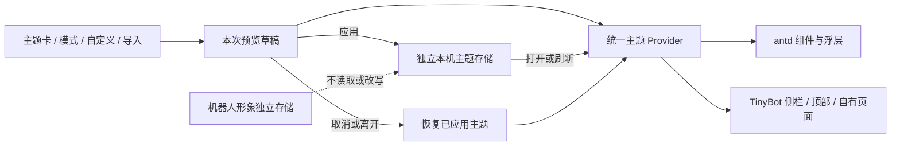
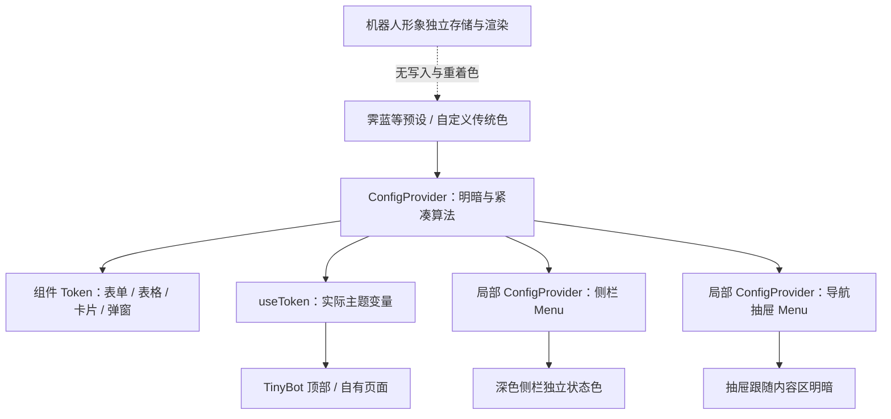

# TinyBot 系统主题中心 · 1.82

2026-11-07；范围为现有 React + antd 三端原型。对应唯一交互合同 [CON-P30](../../tinybot-docs/01、TinyBot-Server/设计文档/console/pages/CON-P30.md)，不新增服务或机器人配置字段。

## 1.82 完整界面主题参考与统一色系

纠正把色系归类、四色色板与界面审美混为一谈的问题。目录与自定义色卡共同调用 `classifyColorFamily`，继续支持按主题色/侧栏色独立筛选。新增30套来自 tweakcn 完整界面配方的候选，优先展示为“界面主题”；原300套 Color Hunt 适配组合收进“既有搭配”，不再作为本轮视觉质量的完成证明。霁蓝与经典保留。

30套采用独立 interface-* ID，配套浅深模式、卡片、文字、边框和侧栏选中态，映射到antd Token及Menu组件配置。保留八字说明。完整配方进入自定义后保留引用；手动改颜色/侧栏样式时退出整套引用，之后采用原有独立选色规则。自动搭配只抽取当前色系的完整界面配方，未收录或没有其它候选时禁用，不随机造色凑数。原629个ID、旧保存值和机器人配置不迁移，未应用不写入。

本轮30套不是“每色系30套”已完成；橙/黄等按现有色卡规则仍有覆盖缺口。该数量目标继续保留，后续从实际界面参考补充，不把来源人气、工程对比度或本机测试冒充用户审美验收。来源、适配、许可和证据见 [交付记录](evidence/interface-themes-1.82/README.md)。侧栏内外边距与其它布局未修改。

## 1.77 历史色系筛选

目录按当前实际显示颜色判断色系，支持“按主题色”和“按侧栏色”，数量在浅色/深色切换后重新统计；不再用来源分组或固定每系30套作为界面分类。两维互不替代，红主色＋蓝侧栏可以通过对应依据找到。浅蓝/深蓝按色相与HSL饱和度辨认，避免绝对通道差小就误归纯灰。切换依据/色系/模式恢复第一页，自定义卡同样使用所选依据。历史来源分组仍保留用于追溯，原主题和机器人配置不修改。

19项相关测试、类型检查、构建和三个浏览器视口验证通过，详见[1.77证据](evidence/theme-classification-1.77/README.md)。以下1.76及更早章节为演进记录，色系筛选以本节及CON-P30最新增量为准。

## 当前主题合同（1.76）

- 成熟度：`console-ui-candidate-1.76`，实现与本机浏览器检查完成，待用户视觉评审。沿用Agent Buddy紧凑布局；本轮只更换精选目录、说明与自动搭配，不重排导航、抽屉或业务页。
- 目录：十个色系各30套，300套包含默认霁蓝，另保留经典风格；299套新的界面配方基于175张Color Hunt原始色板，来源和实际HEX见[审计目录](evidence/theme-curation-1.76/theme-audit.json)。全部推荐卡恢复八字说明。
- 层级：新配方主色相对亮度≤0.18、浅色底色≥0.80（当前参考适配多数≥0.90），侧栏亮度低于页面。新v3深色模式继续保持侧栏较页面深；原霁蓝/历史主题的深色渲染保持兼容，不自动重写。
- 自动搭配：从当前色系的完整精选配方随机选择，跳过当前组合，保留名称及全部appearance，不跨来源随意拼色。手动选色保持自由，机器人颜色资产不参与。
- 兼容：palette_version=2的299套历史ID与31套初始ID保留，新增299个curated-* ID及v3语义，注册表共629个ID；schema_version仍为1。默认霁蓝保持原色值；没有任何读取时写回、清理或自动迁移。
- 可读性：当前300套主题正文/按钮/侧栏检查的最低对比度约5.028:1；这是指定颜色组合检查，非整套产品无障碍认证。
- 来源：Color Hunt提供参考关系，Ant Design与Radix提供界面层级规范。参考色板是人类策展/源站受欢迎记录，TinyBot适配为候选；不将原站收藏算作TinyBot审美验收。
- 当前页面已移除顶部设置快捷导航和导入导出入口；保留侧栏设置导航。以下较早章节记录历史实现，冲突时以本节与CON-P30最新增量为准。

来源和三端证据见[1.76记录](evidence/theme-curation-1.76/README.md)。

## 入口与交互

- 设置 → 外观与主题，或右上角头像 → 系统主题中心。路由为 `#/w/demo/settings/general?item=theme`，不改变其他已有页面编号。
- 默认风格保留；新增十套完整的中国传统色主题。每张卡展示侧栏、顶部、卡片、表格、按钮的缩略图。
- 模式独立选择：浅色、深色、跟随系统。后者监听 `prefers-color-scheme`，应用后刷新仍保留；显式模式不会随系统变化。
- 默认开启实时预览；关闭预览时仅选择草稿。点击“应用主题”才写入本机。取消预览、离开主题页面或刷新未应用草稿，均回到已应用主题。
- 自定义支持主题名称、中国传统色 742 色 / 中国传统色 · 故宫 384 色两套目录的主色检索、任意六位 HEX 主色/页面底色/侧栏配色及柔和彩色、清浅、深色侧栏。主色及背景会按明暗模式生成实际色阶，必要时调整对比度，因此锚色不一定直接成为按钮原色。
- 当前原型保留一个可命名、可重复编辑的自定义主题槽位；切换预设时保留已应用配置内的自定义主题。导出 JSON 可另存多套，导入先预览、应用后保存。只做前端本机偏好，不接账号同步或真实服务。
- 文件限 16 KB，导入只保留受控字段；不执行 JS、不接受颜色 URL 或任意 CSS。失败保留当前草稿与已保存配置。

## 十套传统色预设

| 风格 | 上游颜色 | 固定颜色 ID | 原始锚色 | 浅色侧栏 |
|---|---|---|---|---|
| 霁蓝 | 霁蓝 | traditional742-695 | #1E5A8F | 深色 |
| 官绿 | 官绿 | traditional742-652 | #7AA35A | 柔和彩色 |
| 朱砂 | 朱砂红 | traditional742-607 | #D92121 | 清浅 |
| 月白 | 月白 | traditional742-424 | #EEF7F2 | 柔和彩色 |
| 墨玉 | 墨玉 | traditional742-593 | #2E4B3A | 深色 |
| 暮山紫 | 暮山紫 | traditional742-535 | #6E4D7E | 深色 |
| 秋香 | 秋香 | traditional742-551 | #C3B787 | 柔和彩色 |
| 海棠 | 海棠红 | traditional742-240 | #F03752 | 清浅 |
| 藕荷 | 藕荷 | traditional742-171 | #EDC3AE | 柔和彩色 |
| 松花 | 松花 | traditional742-580 | #B6D7A8 | 清浅 |

当前默认风格的侧栏、背景、主色、字体、尺寸和折叠行为保留；默认浅色次要文字做最小加深，以改善背景上的阅读对比度。新增主题检查正文、次要文字、链接、按钮、导航选中状态的对比度；未将本次检查等同于整套产品的 WCAG 认证。状态色保持独立，机器人形象和品牌/厂商图像不随主题重着色。

## 结构与存储



- `src/system_theme.ts`：固定预设、纯色阶生成、对比度计算、模式解析、严格导入校验和独立存储读写。
- `src/system_theme_provider.tsx`：已应用配置 / 预览草稿 / 系统媒体查询及跨标签页偏好更新；同时驱动 antd 主题与受控 CSS 变量。位于 `AntApp` 之上，确保 `useApp` 的确认弹窗与消息同样有主题。
- `src/pages/ThemeCenter.tsx`：预设、自定义、预览应用及 JSON 文件流；`system_theme.css` 只处理控制台主题角色，不修改机器人 SVG/Canvas 色值或形象资源。
- 本机键为 `tinybot.system-theme.v1`；机器人仍为 `tinybot.character-presets.v1`，主题读写函数只访问自己的键，不调用清理存储，不改角色、模型或声音配置。
- 已保存主题优先于普通链接中的 `theme=light/dark`；没有已保存主题时兼容旧链接。并排预览器的父窗口消息只临时指定明暗，不持久化偏好。
- 无主题记录时不自动写入；数据损坏或存储失败显示错误，不自动覆盖原文。自定义取消恢复进入弹窗前的草稿；完成定制仍需点击应用。

JSON 示例：

```json
{
  "schema_version": 1,
  "preset_id": "custom",
  "mode": "system",
  "custom": {
    "name": "我的青瓷",
    "primary": "#16806A",
    "background": "#F7F8FA",
    "sidebar": "#1E5A8F",
    "sidebar_style": "dark"
  }
}
```

## 来源与平台边界

传统色目录来自[中国传统配色网站](https://colors.xiaoxiaodong.ai/dictionary?family=red)和 [nevertoday/zhongguo-traditional-colors](https://github.com/nevertoday/zhongguo-traditional-colors)，使用前一轮已固定的数据提交。完整来源、指纹、742 色范围和上游 LICENSE/README 冲突见[来源文档](src/vendor/traditional_742/README.md)。Theme Forge 提供语义主题思路参考；本次自行实现 antd 和 TinyBot CSS 适配，未复制其 shadcn 页面或主题生成脚本，也没有将其 globals.css 直接注入 TinyBot。

继续使用已安装 antd 的 `ConfigProvider`、明暗算法与组件 Token，不引入 layui 运行时、远程主题脚本或新依赖。Web、Desktop、Tablet 前端可复用同一实现；原生窗口标题栏、原生系统控件、移动系统 UI 和 ESP32 屏幕不属于本次主题覆盖范围。原型没有接入 Tauri 或设备。

验证见 [1.44 记录](evidence/system-themes-1.44/README.md)。用户视觉验收仍待进行。

## 1.45 选色色库更新

自定义主题的“中国色色库”提供“中国传统色 · 742 色”与“中国传统色 · 故宫 · 384 色”，分别按色名/HEX（传统色另含编号）检索；切换色库仅浏览，不改颜色。当前颜色属于故宫独有 HEX 时，再次进入定制会识别对应目录。主题文件继续保存原 HEX，不新增库标识，不改已有主题或形象格式。来源边界见[中国色目录说明](CHINESE-COLOR-CATALOGS.md)。

## 1.46 抽屉与统一色块面板

定制入口使用 antd Drawer，桌面 920px，平板与手机全宽；桌面/平板预览设置与色板并排，窄屏紧凑上下排列。底部固定取消和完成，抽屉自带动画；取消、关闭和 Escape 恢复进入前草稿，完成后仍需应用。

直接复用 `CharacterPalette` 的命名色块、自定义取色、搜索及别名。全部颜色、基础配色、中国传统色 742、中国传统色 · 故宫 384、莫兰迪、国际常用色、Pantone、RAL 通过标签式 Radio.Group 单选；色系和节气也用单选，不使用下拉。选“主色 / 页面底色 / 侧栏配色”作为编辑目标，点击色块仅修改该目标；切换源、筛选与搜索不改色。主题回调将既有颜色 ID 解析为 HEX 再写入草稿，保持原主题 JSON 和机器人持久化规则。

共享面板增加 theme 展示用途与初始目录参数，机器人默认用途继续回传原 ID / 原 HEX；没有另建一份色库或修改原始资产。方向键使用框架原生 Radio.Group，相同组具有一致原生 name；本次自动化未能模拟原生单选方向键，未计入实测通过项。Escape、唯一选中、点击切换与三端选色完成实测。详见[1.46 证据](evidence/theme-drawer-1.46/README.md)。

## 1.47 默认主题调整

系统默认改为霁蓝：首次使用、无存储、异常回退及恢复默认均指向 `jilan`，恢复时保留当前明暗模式。原薄荷风格保留为“TinyBot 经典”，`default` ID 与原色值不改；已保存的经典或自定义选择仍原样读回，不进行静默迁移。默认卡片在列表首位，显示默认标记。本次不更改机器人形象配置或服务。

定制抽屉内色块区域完整展开，不设置独立高度或内部滚动条；长色表由抽屉正文统一滚动，底部取消/完成固定。该覆盖仅作用于主题抽屉，其他机器人选色面板保留既有滚动范围。


## 1.49 统一到官方 Design Token 与 Menu

`src/antd_theme.ts`集中构造ConfigProvider配置：预设与自定义HEX保留为配色意图，通过defaultAlgorithm/darkAlgorithm与compactAlgorithm派生实际Token，并配置Menu、Button、Input、Select、Table、Card、Modal、Drawer。`resolveThemeColors`让主题缩略图使用同一配置的getDesignToken结果；`ThemeTokenBridge`使用useToken，将实际值映射给既有壳变量。传统色数据、预设ID、主题schema_version及存储键均不变，机器人资产继续独立。



Menu使用官方组件状态和动效，不再渲染旧nav-item按钮或自制子菜单高度动画。`src/ShellNavigation.tsx`共用三端菜单；`shellSelection/shellTarget`仅将稳定菜单键映射到已有页面与局部视图。父项只收展，子项进入原页面；角色与设备详情回显所属列表。桌面整体侧栏保留1.48点击切换，不恢复悬停浮层。

侧栏配置覆盖itemColor/itemHoverColor/itemSelectedColor及对应背景、禁用色、分组和子菜单状态，并配置darkItem系列；触控导航抽屉独立配色。对比度检查使用最终派生色和实际静止状态，主题过渡帧不用于静止状态判断；未宣称整站无障碍认证。减少动态效果偏好经官方motion Token传递到Menu与浮层，自有壳遵循相同动效时长。

官方参考：[主题机制](https://ant.design/docs/react/customize-theme-cn/)、[Menu组件与Token](https://ant.design/components/menu-cn/#design-token)。技能中的4.x示例未直接作为6.6.5实现依据。运行证据见[本轮记录](evidence/antd-token-1.49/README.md)。


## 1.50 高级外观编辑

参考[官方主题编辑器](https://ant.design/theme-editor-cn/)的颜色、尺寸、风格分类，定制抽屉分为配色、文字、边框、风格、紧凑度。Desktop1000px右侧抽屉，Tablet/Mobile全宽；桌面及平板两列，窄屏单列，底部固定恢复默认/取消/完成。色板保持完整展开，整个抽屉正文统一滚动。

| 组 | 可配置项 | antd适配 |
|---|---|---|
| 配色 | 原主色、页面底色、侧栏配色及风格 | 原Seed/Alias/局部Menu配置保持 |
| 文字 | 标题/正文/次要文字色、字号12～18、行高1.3～2 | colorTextHeading/colorText/colorTextSecondary/fontSize/lineHeight；各组件字号跟随 |
| 边框 | 颜色、0/1/2px、实线/虚线/点线 | colorBorder/colorBorderSecondary/lineWidth/lineType；无边框时焦点描边仍保留2px |
| 风格 | 基础圆角0～16、默认/无/柔和/标准/明显阴影 | borderRadius及大圆角梯度、boxShadow系列；控制台卡片同样取实际Token |
| 紧凑度 | 紧凑/适中/宽松 | 官方算法组合、controlHeight、Menu高度、Table行内边距及Card内边距；触控至少40px |

高级字段是custom.appearance内的可选覆盖。数字与枚举严格校验；颜色只接受六位HEX，按colors.light/colors.dark分别保存。读取旧主题不补写默认字段；主题schema_version仍为1。选择颜色时保留原HEX，实际文字必要时调整到可读色，不修改持久化原色。预览保持在ConfigProvider内，inherit=false隔离示例；暂停后背景页面与示例均使用已应用主题。

“恢复本组”删除本组覆盖，文字/边框仅清理当前模式的颜色，保留另一种模式；“恢复默认”重置定制基线，保留名称与颜色模式；取消/关闭/Escape恢复进入抽屉前草稿。完成只回主页面草稿，“应用主题”才写入主题键。

连续编辑时保持自定义字体算法函数身份固定，字体梯度来自官方算法；避免每次输入创建新算法导致缓存异常。预设主题继续沿用1.49配置。组件预览展示真实按钮、输入框、禁用态、复选框和表格，使用实际Token；机器人SVG、Canvas及存储不接入系统主题。

示例：

```json
{
  "font_size": 16,
  "line_height": 1.8,
  "border_width": 2,
  "border_style": "dashed",
  "border_radius": 14,
  "shadow": "strong",
  "density": "spacious",
  "colors": {
    "light": {"text": "#2E5D8C", "border": "#FFF799"},
    "dark": {"text": "#FFF799"}
  }
}
```

以上对象位于custom.appearance，不是独立主题文件。验证及限制见[1.50记录](evidence/theme-customizer-1.50/README.md)。


## 1.51 色系筛选补齐

全部颜色没有单一来源的group字段，旧条件会隐藏分类。本次为主题用途增加按HEX近似归类的红/橙/黄/绿/青/蓝/紫/粉/棕/黑白灰十种单选，显示当前色库容量。色库、检索和来源可联合；故宫另保留节气单选并与色系求交。切换色库重置筛选，切换色系不改当前颜色，空结果展示既有空态。

中国传统色742保留上游八种分类与原计数；不以通用HEX分类替换上游事实。通用分类只是浏览规则，不是官方色彩标准；原色名、来源、同HEX别名、配置ID及机器人用途保持。完整1518个展示色块恰好归属一个通用色系，无遗漏和重复。


### 1.52 色卡顺序与列数

主题选色区固定每行7个色块；全部颜色、各色库及筛选结果均按线性sRGB相对亮度降序，从左到右逐行由浅到深。同亮度保持原相对顺序。只排序展示副本，保留原始名称、来源、别名、ID及已选值；机器人身体配色的原有排列不变。三端不得产生横向溢出，不新增色板内部滚动条。


## 1.54 产品交互以选择为主

本节取代1.50的高级调试界面：恢复左侧226px选择与预览、右侧色卡的布局；手机按缩略图/名称/风格、预览、色卡纵向排列。左侧红框对应区域放置真实antd组件的紧凑实时预览，不再挤占色卡上方。用户只需选主色及清浅/柔和/深色搭配；背景自动混色、正文/次要文字/导航/按钮及选中状态自动校正可读性，边框与紧凑度使用既有默认Token。

内置主题新增20套，合计31套（30套中国传统色+经典），全部保持真实来源颜色ID；按十种色系筛选，各类均有预设。旧11个主题ID与霁蓝默认不变。`systemThemeFamily`按实际色值划分，仅用于浏览，不改变上游色名及存储。`matchSystemTheme`在明确重新选色或风格时生成新草稿；旧高级appearance仍可安全读取，打开/改名/取消不会丢失，明确重新搭配后使用默认成套样式。未做存储迁移，schema_version=1与存储键保持。

筛选、实时预览与定制均不保存，仍由“应用主题”完成独立本地保存。主题与形象配置相互独立，保存兼容性由现有回归覆盖；没有接入真实服务。


## 1.56 主题翻页过渡

新增独立theme_transition.ts调度器与theme_transition.css，不访问localStorage、机器人资产或业务状态。SystemThemeProvider提供transitionSystemTheme，仅在明确切换时调用；React状态使用flushSync配合浏览器快照提交，ThemeTokenBridge在layout effect中同步Token与根变量，防止新旧主题混杂。微任务包装避免在React生命周期中同步刷新。

调度器合并同一轮请求，跳过正在进行的旧动画，版本检查防止迟到回调覆盖最新选择；相同选择也取消旧请求但不做无意义动画。捕获失败仍提交一次更新，ready/finished拒绝均有处理，完成与卸载清除标记。根快照使用短时透视翻页及展开遮罩，只有主题切换标记存在时启用；没有克隆页面和长期覆盖层。桌面/平板420ms，手机360ms。

减少动态效果或隐藏页面不启动动画；浏览器不支持API时直接提交主题。系统减少动画偏好在过渡中改变时立即结束动画。首次载入、搜索、色系筛选及颜色连续调整不触发整页过渡；主页面、定制抽屉和既有头像/基础设置的模式入口统一使用该机制。跟随系统继续响应媒体变化，浏览器拒绝动画时保持正确的最终颜色模式。

动画不改变原保存规则：主题中心仍由“应用主题”保存，头像/基础设置的颜色模式仍沿用原有即时保存行为；schema_version=1、主题ID与独立存储键不变。原主题全部可选字段保留；机器人形象配置和绘制资源保持独立。

参考：[MDN Document.startViewTransition](https://developer.mozilla.org/en-US/docs/Web/API/Document/startViewTransition)、[MDN skipTransition](https://developer.mozilla.org/en-US/docs/Web/API/ViewTransition/skipTransition)、[React flushSync](https://react.dev/reference/react-dom/flushSync)。


## 1.57 左上角扩散的视觉修正

取代1.56的旋转/亮度与透明叠加CSS：旧主题静止、不透明，z-index=1；新主题不透明且位于上层，从circle(0 at 0 0)扩展至circle(150vmax at 0 0)。终点半径超过任意视口对角线。仅替换theme_transition.css，不修改调度器、页面结构、主题数据、存储与机器人资源。三端opacity实测均为1、transform为none，480/480/420ms；减少动态效果继续直接更新。


## 1.58 外观快捷选择

在左栏真实组件预览下方增加四组Radio预设：font_size=12/14/16（小/中/大），density=compact/comfortable/spacious（紧凑/标准/宽松），border_radius=0/7/12（方正/标准/圆润），shadow=none/soft/strong（无/柔和/明显）。映射现有appearance字段，复用systemThemeConfig的官方算法、组件Token和根变量适配；没有新增存储字段或任意CSS输入。

ThemePreview读取实际Token：字号梯度、行间/内边距、Card圆角与阴影均参与变化。显式设置Card圆角，避免历史通用.ant-card样式将真实Token覆盖为固定10px。紧凑默认字体按当前实际12px回显，旧13/15px等值就近显示档位但不自动改写；在未指定字号时切换密度会锁定当前实际字号，避免文字隐式增减。

setThemeQuickOption仅接受档位值，resetThemeQuickOptions只清理四组字段，保留色值和其他历史覆盖。matchSystemTheme换色或侧栏风格时延续这四组，颜色覆盖仍由新的自动搭配生成；此规则取代1.54“重配后清空全部高级覆盖”的对应部分。只修改草稿，恢复默认、取消和完成/应用仍按既有规则。

保持两列布局，左侧随整个抽屉正文滚动，避免设置增多后底部档位不可达；移动端顺序为形象缩略、名称/风格、预览、快捷设置、色卡。快捷点击不触发整页扩散，浅深模式继续使用1.57过渡。183项测试通过，三端点选与取消流程见验证记录。

参考：[antd官方主题机制](https://ant.design/docs/react/customize-theme/)，使用Design Token与组件配置，不是让用户输入底层参数。


## 1.59 放慢并增加纸页折面

本节替换1.57的圆形揭示：注册长度变量--theme-turn-edge，在900ms内从-80px推进到100vw+100vh。新旧根快照使用互补多边形裁剪，之间保留纸页折面；渐变仅绘制不透明纸背的亮部、暗部与接触阴影，不把渐变覆盖在内容上。纸面颜色于切换前读取旧surface并暂存在根样式，结束/取消时移除。不复制业务DOM，不修改主题或形象数据。

旧/新快照opacity=1，无交叉淡化，组件transition在捕获期间归零，确保新画面是确定的目标颜色。左右布局、快捷设置、霁蓝默认、保存格式及原有减少动态效果/快速切换规则不变。纸背是二维折面模拟，不声称物理三维纸张仿真。

参考：[MDN注册CSS属性](https://developer.mozilla.org/en-US/docs/Web/CSS/Reference/At-rules/%40property)。验证见evidence/theme-book-1.59。


## 1.61 三个独立配色目标恢复

简化定制不再限制为主色：左栏提供主色primary、页面底色background、侧栏配色sidebar的单选和色值行，切换目标只改变编辑指向，右侧共享色库与原自定义颜色组件。目标标题、值与高亮同步；没有增加颜色滑块或多套表单。

editThemeTargetColor编辑底色/侧栏时只改对应原字段；编辑主色先比较原值与当前主色的自动搭配结果，不相等的独立颜色继续保留，相等的颜色随新主色自动搭配。没有新增持久化的手动标记；一键“自动搭配”明确重新生成三色并保留font_size/density/border_radius/shadow。侧栏风格只修改sidebar_style，不重置配色。

数据仍为schema_version=1原字段，导入导出、取消和完成/应用保持。三端目标选择及值独立性已验证，浏览器不点击应用主题，未写入用户配置；机器人颜色资源不参与该流程。


## 1.63 新页面从左上角展开覆盖

取代1.59的斜向折面渐变：旧主题根快照保持完整、静止、不透明，新主题根快照置于上层，仅动画其clip-path，从左上角circle(0%)展开至circle(141.5%)。百分比半径按对角线/√2计算，终点略越过最远角；三端统一1100ms，保留明显可见的新旧页面分界。不缩放页面内容，不绘制光带、纸背、阴影、背景渐变或透明遮罩；旧快照不再裁剪。

主题仍由antd6.6.5的ConfigProvider、Design Token与组件配置提交，展开层使用浏览器原生View Transition，与antd控件动效分开。快照关闭默认交叉淡化和mix-blend，捕获期间暂停组件颜色transition，避免新页面截到过渡中间色。删除不再使用的--theme-turn-paper临时变量，其余调度与保存规则保持。

当前原型布局、霁蓝默认、中国色色库、快捷选项、自定义配置字段和机器人形象均不变。减少动态效果、无API、隐藏页面继续直接更新，快速选择仍由同一调度器取消旧动画并以最后选择为准。动画不读写持久化配置。

官方参考：[antd动态主题](https://ant.design/docs/react/customize-theme/#switch-themes-dynamically)、[Ant Design过渡设计](https://ant.design/docs/spec/transition/)、[MDN自定义View Transition](https://developer.mozilla.org/en-US/docs/Web/API/View_Transition_API/Using#customizing_your_animations)。antd官方文档用于换肤机制，MDN示例用于不透明新页面覆盖，并非使用antd内置“翻书组件”。

验证见[evidence/theme-reveal-1.63](evidence/theme-reveal-1.63/README.md)：旧动画实际运行断言为polygon与渐变，新动画三端模式/主题共6组为circle、opacity=1、旧clip=none、overlay=none。188项测试、类型检查和构建通过，浏览器配置比较保持不变。


## 1.64 字号与字体

纠正快捷项名称：“字号”控制小/中/大（12/14/16px）；“字体”独立使用 antd Select，提供系统默认、黑体、宋体、楷体、圆体、等宽六种字体族。选项以各自字体显示“Aa 中文”，真实组件预览展示“角色、知识与设备 · Aa 123”，控件保持既有尺寸及布局。

新增可选 appearance.font_family，保存受控标识 system/sans/serif/kai/rounded/mono，拒绝任意CSS、URL或未知值。systemThemeConfig映射到antd Design Token fontFamily，自有外壳使用从实际Token派生的 --console-font-family；嵌套预览也使用同一Token。未配置时沿用原字体链，不迁移旧主题；换色或自动搭配保留字体，恢复快捷默认清理五种外观覆盖。取消恢复原草稿，完成定制后仍需应用才持久化；主题和机器人形象继续独立存储。

字体按设备可用字库匹配并回退到通用字体族，不读取系统字体清单、不下载或嵌入商业字体文件。因此字形由浏览器及设备决定，选项不表示所有平台均安装同名字体。参考：[antd Design Token](https://ant.design/docs/react/customize-theme/)、[MDN字体匹配与回退](https://developer.mozilla.org/en-US/docs/Web/CSS/Reference/Properties/font-family)。

验证：新增字体解析、保存读回、换色保留、非法值拒绝、重置及机器人配置保护测试；三端浅/深Token映射均覆盖。191项测试、类型检查、构建通过。浏览器按1280×1024、768×1024、390×884检查选择、字号独立及取消，实际配置前后相同。证据见[evidence/theme-font-1.64](evidence/theme-font-1.64/README.md)；不等同于Android/iPad原生设备字库验收。


## 1.65 统一快捷设置，配色紧邻色卡

ThemeQuickSettings合并风格与原五种快捷外观，位置仍在左侧效果预览下方。首行为“风格＋清浅/柔和/深色”，与字号等行共用对齐及尺寸规则；删除独立搭配风格区及说明。恢复入口重置风格为默认dark并清除五种快捷覆盖，保留名称、主色/底色/侧栏色及其它历史外观设置。

右侧色卡容器顶部放配色区与自动搭配。三项antd Radio一次呈现标签、当前色块和HEX，只有三个入口，不再同时渲染三按钮与三行重复值。切换目标只改变色库指向，实际选色沿用editThemeTargetColor；手动底色/侧栏、自动搭配、字体与颜色保留、取消/应用规则及数据格式保持。Mobile随原布局折为一列，三个配色入口仍并排且超过40px触控高度。

新增合并恢复的行为测试，先确认旧实现不能恢复风格，再实现。192项测试、类型检查与构建通过，三种指定视口验证六行快捷项、右侧目标归属、无重复入口、同排色值与无横向溢出；实际选色、自动搭配及取消后的存储比较均通过。截图和记录见[evidence/theme-layout-1.65](evidence/theme-layout-1.65/README.md)。仅浏览器原型，不代表原生设备或服务验收。


## 1.66 效果预览放在快捷设置下方

左栏改为主题名称、统一快捷设置、效果预览；三端共用相同组件顺序。仅移动JSX位置，右侧配色、设置值与存储规则保持。


## 1.68 侧栏样式和基色同属配色

右侧名称下方的配色区增加“侧栏样式：清浅/柔和/深色”同排选择；原“侧栏配色”统一改称“侧栏基色”，下方选色标题同步。左栏快捷设置只包含字号、字体、间距、圆角、阴影，真实效果预览继续在其下。样式仍使用sidebar_style，基色仍使用sidebar，不迁移数据、不改变颜色生成算法。

左栏恢复现在只清理五项快捷外观，保留右侧侧栏样式及颜色；更新行为测试先暴露dark覆盖light的问题，再实现保留。192项测试、类型检查与构建通过。三端浏览器检查同排样式、左右归属、五项顺序、预览位置、基色名称和无水平溢出，触控样式高度40px；取消后主题/机器人相关存储保持原值。见[evidence/theme-sidebar-style-1.68](evidence/theme-sidebar-style-1.68/README.md)。


## 1.69 免费中文字体资源与按需加载

快捷设置调整为字体、字号、间距、圆角、阴影。保留system/sans/serif/kai/rounded/mono六个旧ID及回退链；新增10个受控ID，仍通过appearance.font_family和antd fontFamily保存与呈现，不改变主题版本、颜色或机器人配置。菜单按系统字体、免费中文界面阅读、免费中文艺术手写分组，支持中文名称搜索。

新增目录：阿里巴巴普惠体3.0、小米MiSans、Noto Sans SC、Noto Serif SC、霞鹜文楷轻便版、得意黑、站酷小薇体、站酷快乐体、马善政楷书、龙藏体。字体原文件由官方CDN/项目发布/Google Fonts仓库取得，未修改字形；小米与阿里沿各自官方许可/商用声明，其他沿对应OFL原文，不将免费商用混称为开源。界面提供“来源与授权”，其中明确注明使用MiSans，保留其完整原许可。

public/fonts包含原始字库、许可、来源索引和SHA-256清单。构建复制到dist/fonts并为两种HTML入口加载本地font-face样式表，不在构建时访问远端。普通字体使用原WOFF2/TTF，MiSans直接保留官方56个unicode分片和可变字重。字体声明本身不下载字库；菜单中未选择的新字体不设置专属font-family，避免仅打开目录就下载十套。font-display:swap保证首次请求期间仍能阅读，已选字体按浏览器缓存复用；缺少的字符仍按原回退链显示。原6项系统字体不复制商业字库、不执行系统安装。

资源约88MiB随原型提供，属于包体大小而非首页下载量。新增两个验证项覆盖排序/目录及所有字体资源原字节校验、许可、CSS本地路径；既有字体保存/字号独立/机器人隔离测试扩展覆盖16项。194项测试、类型检查与构建通过。Desktop逐款用浏览器实际字形来源确认10款新字体，三端检查字号顺序、真实预览与根字体一致、无水平溢出及取消后的配置保护。首次打开目录字体文件请求为0，字体请求均同源且未出现加载错误。见[evidence/theme-free-fonts-1.69](evidence/theme-free-fonts-1.69/README.md)。

官方来源及许可：[阿里巴巴字体](https://www.alibabafonts.com/)、[MiSans嵌入许可说明](https://hyperos.mi.com/font/zh/faq/)、[LXGW](https://github.com/lxgw/LxgwWenKai-Lite)、[得意黑](https://github.com/atelier-anchor/smiley-sans)、[Google Fonts字库与各自OFL](https://github.com/google/fonts/tree/main/ofl)。仅本机浏览器三视口验收，Android/iPad原生字体加载仍需目标设备验证。


## 1.70 样式和配色同级顶栏

右侧名称下方改为一条横向顶栏：左侧侧栏样式及三选项，右侧配色与自动搭配。两个分组垂直居中且同级字样，下方颜色目标与色卡保持。三端无横向溢出，两个分组中心线差为0；触控样式与自动搭配高度至少40px。仅调整JSX与样式，类型检查与构建通过，未重复运行无行为变更的全量测试。截图和几何记录见evidence/theme-header-1.70。


## 1.71 仅提供网页字库，不依赖系统安装

取代1.69“6个系统项＋10个网页项”的选择方式。菜单现在仅提供11个有本地原字库的选项，新增LXGW WenKai Mono Lite承接等宽；移除系统字体分组及六个系统选项。默认未指定字体时使用网页Alibaba PuHuiTi 3.0，root、antd及比较页外框共用网页字体；各选项回退链移除苹方、微软雅黑、宋体、楷体等设备名称，优先使用随包Noto Sans SC/Noto Serif SC。font-face只有本地URL、不含local()，选择同一项使用相同原字库，不要求系统安装。

旧配置读取兼容如下，解析仍保留原ID，回显和Token映射才使用网页ID，不自动改写存储：

| 旧ID | 网页映射 |
|---|---|
| system | alibaba：阿里普惠体 |
| sans | noto_sans：Noto黑体 |
| serif | noto_serif：Noto宋体 |
| kai | wenkai：文楷轻便版 |
| rounded | zcool_kuaile：站酷快乐体，近似映射，不声称保留原系统圆体字形 |
| mono | wenkai_mono：文楷等宽轻便版 |

首次网络加载期间font-display:swap仍可临时使用浏览器兜底；正常加载后优先使用同一套网页字库及Noto回退。通用字体族仅作为资源失败或超出字库覆盖时的最终兜底，不作为菜单选项。系统文字抗锯齿及特殊Unicode覆盖不属于“所有操作系统逐像素相同”的保证。新增两个测试验证无平台字体依赖、六ID只读兼容，现共196项通过；类型检查、构建通过。默认字体依赖测试先在旧实现失败，再切换网页默认。

浏览器逐款检查11套预览的实际字形来源，样例中17个字形及缺字回退均来自isCustomFont=true；Tablet的MiSans与Mobile的站酷小薇＋Noto回退同样全部来自网页字库。保存主题/机器人相关存储前后逐字相同。详见[evidence/theme-web-fonts-1.71](evidence/theme-web-fonts-1.71/README.md)。当前为本机浏览器三视口验证，不替代Windows/Android/iPad物理设备验收。


## 1.72 两个完整分组左右并列

取代1.70的单条顶栏：左组标题侧栏样式，下面三个样式选择；右组标题配色/自动搭配，下面三个颜色目标，等宽两列。标题行与控件区分别上下对齐，选项最小54px。窄屏保留左右两列，组内选项改为纵排，去除antd相邻单选项的负外边距以避免边缘超出1px。颜色库、字体、保存与预览行为保持。三端实际几何记录无页面/面板溢出，标题、选项顶部/底部差均为0，类型检查和构建通过；本轮未重复业务测试。见evidence/theme-groups-1.72。


## 1.73 侧栏样式与配色上下两行

按最新反馈不再左右两列，改为上下两组，像主题名称一样各自标题在上、选择项在下。选择项从54px降至28px，三端按本次明确高度要求统一；配色色名、色块和HEX横向单行。网页字库、颜色算法和保存逻辑不变。三端实际六个选择项高度均为28px，组顺序正确、无页面/文本溢出，Mobile点选通过，构建通过；本轮纯CSS未重复业务测试。见evidence/theme-compact-rows-1.73。

## 1.74 可商用网页字体扩充

保留原11款及历史ID映射，新增19款实际网页字体，总计30款：25款包含中文、5款拉丁与等宽。分为界面阅读、圆体与楷书、艺术手写、标题展示、拉丁与等宽；支持名称搜索与实时预览，仍位于字号上方，不改当前定制布局。繁中字体明确标注，缺失简体字及拉丁字体中文回退到随包Noto，不通过OS匹配冒充加载。

新增原字库与OFL 1.1全文、官方URL和SHA-256随包保留，允许商业使用及网页嵌入，保留版权许可且不单独出售字库。字体按选择加载，菜单不预加载所有字体。原配置不自动改写、机器人形象不参与此流程。测试先红后绿，197项通过，类型检查、构建通过；Desktop新增19款实际字形全部来自网页字库，Tablet/Mobile代表字体选择与预览通过，取消后保存数据未变。证据见原型evidence/theme-font-library-1.74；这是本机浏览器三视口验证。当前原始字库资源约286.4 MiB，首屏不整包加载，未接真实服务。

## 1.75 每色系30套规则配色与随机组合

十个色系共300套推荐搭配；霁蓝仍默认，包含在蓝色系内，经典额外保留。所有新配方为深主色（相对亮度≤0.18）、浅底色（≥0.80）、独立侧栏；生成阶段预留主色/背景4.8:1对比度，避免组件可读性调整后压缩差异。每色系实际浅色渲染三色的两两OKLab均方根色差≥8，最低约8.0097，三色组合全局无完全重复。工程门槛不代替用户审美评审；派生配方不冒用传统色原色名称。

主题选色区增加全部/深色/浅色，按目标默认dark/light/all，保留手动选色自由、搜索、色系及故宫节气。自动搭配随机组合本色系三色与独立侧栏，避开当前相近配方，保留名称和全部appearance。palette_version:2仅用于明确采用新配色语义的组合，palette_family保留调暗后的色系身份；schema_version保持1，旧字段和旧主题ID读取不变，不主动迁移。原始色库及机器人配置不参与。

按最新反馈移除系统主题页顶部设置导航和导入导出入口，保留侧栏入口；300套目录每页12项。199项测试、类型检查、构建通过；十色系三页逐项数量、三端深浅目标/随机/取消、字体字号保留和旧保存值保护通过。本机浏览器三视口验证，视觉待用户评审，证据见原型evidence/theme-combinations-1.75。
