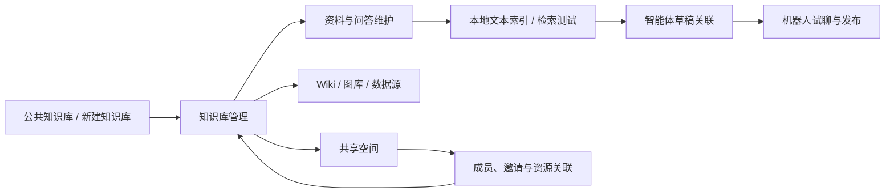

# 知识工作区与共享空间整合（2.14）

## 范围与事实源

本次在 TinyBot Web 的现有知识库菜单整合 WeKnora 的知识工作区交互。以用户提供的创建配置截图、现有 `knowledge-creation.md` 与本文作为增量交互合同；没有初始化新规格体系。创建编辑器的 10 项配置与 FAQ 配置保留。

参考仓库：`/Users/wandl/workspaces/workspace-agent-fabric/research/WeKnora`，本轮读取提交 `cbdcebabf48c5ee2d6868b370326aa8341703f62`。上游 Vue / TDesign 的页面职责和交互移植到 React / antd，未引入 Vue 或替换 TinyBot 外壳。来源根目录 MIT 许可；本次界面结构、术语和连接器目录的参考保留在此。

| WeKnora 源码（frontend/src 下） | TinyBot 对应实现 | 本轮交互 |
|---|---|---|
| views/knowledge/KnowledgeBaseList.vue | pages/KnowledgeWorkspace.tsx | 全部、收藏、最近、本空间、共享；搜索、排序、置顶、复制、配置、删除 |
| views/knowledge/KnowledgeBase.vue、components/DocumentListView.vue、DocumentCardView.vue | pages/KnowledgeDocuments.tsx | 列表/卡片、文件夹、标签、状态筛选、批量选择/移动/重解析/导出/删除 |
| components/KbUploadSourceDropdown.vue、manual-knowledge-editor.vue、doc-content.vue | KnowledgeDocuments + 现有 DocumentDetail/ChunkEditor | 多文件/目录导入、URL 登记、Markdown 编写、原文/切片维护与本地文本索引 |
| components/FAQEntryManager.vue | pages/KnowledgeFaq.tsx | 标准问、相似问、反例、多答案、标签、列表/卡片、批量启停、JSON 导入导出 |
| wiki/WikiBrowser.vue、WikiRevisionDrawer.vue | pages/KnowledgeViews.tsx | 手工 Wiki、来源文档、页面关联、历史版本、恢复与页面关系图 |
| gallery/ImageGallery.vue、GalleryViewer.vue、ImageEvidenceEditor.vue | pages/KnowledgeViews.tsx | 本地图片预览、名称/描述/标签/来源编辑与筛选 |
| settings/DataSourceSettings.vue、DataSourceEditorDialog.vue、DataSourceSyncLogs.vue | pages/KnowledgeViews.tsx、knowledge_sources.ts | 13 种上游连接器目录、按类型显示字段、同步计划、启停、配置更新、同步未执行日志 |
| settings/KBShareSettings.vue | KnowledgeSharing + SharedSpaceDetail | 共享到空间、只读/可编辑资源属性、共享列表、撤销关联 |
| settings/KnowledgeBaseActivitySettings.vue | KnowledgeActivity | 当前会话资料来源、状态与更新时间；系统审计沿用既有入口 |
| views/organization/OrganizationList.vue、OrganizationSettingsModal.vue | SharedSpaces、SharedSpaceDetail、SharedSpaceJoin | 创建/更新/加入、资源共享、成员角色、邀请码有效期/撤销、加入审核/搜索发现/人数上限、退出与解散 |

上游连接器：飞书知识空间、Lark 知识空间、飞书云盘、Lark 云盘、Notion、Confluence、语雀、钉钉、IMA、RSS、GitLab、Seafile、Nextcloud。网页、通用 WebDAV、S3 是 TinyBot 已有/扩展配置，不能标作来自本轮 WeKnora 连接器定义。当前连接器表单只做本地配置演练，没有真实连接校验、资源树发现或后台同步。

## 菜单与页面

知识库仅保留三个主入口：公共知识库、知识库管理、共享空间。图库、Wiki、数据源、共享、活动与检索设置属于具体知识库详情，不新增一级菜单。公共知识库继续使用现有示例知识包、预览、加入和关联智能体草稿流程。

## 数据与兼容规则

- 资料与问答共用 `Store.docs`，知识库共用 `Store.knowledge`，智能体继续通过知识库 ID 引用；没有复制一套仅供展示的数据。
- 仅增加可选的资料文件夹、标签、来源、更新时间字段。原数据缺失时显示“未分类”“文件上传”，不批量修改旧记录。
- `ProductState.knowledgeWorkspaces` 保存收藏、访问记录、文件夹、Wiki、图片、数据源；`sharedSpaces` 保存成员与资源 ID。均为当前会话数据，刷新后回到初始示例。没有把内存数据宣称为后端持久化。
- 系统主题、网页字体、系统标识、机器人形象及其持久化键不修改。
- 复制知识库生成新 ID，复制配置与资料，重新索引，不继承原共享、Wiki 历史、模型凭据或智能体关联。
- 跨库移动保留资料 ID 和原文，索引变为待重建；原库的页面若引用移走资料，将显示来源已移除。
- 删除知识库前检查草稿、已发布版本及设备覆盖配置；存在引用就阻止。删除成功同时清理资料、空间共享和辅助工作区。
- 撤销共享、退出或解散空间不删除源知识库、源智能体。最后一位管理员不能被移除或降权；须先转让管理员再退出。
- 邀请码生成与加入使用同一会话目录。过期、撤销、不匹配、重复加入沿用校验；没有发起真实跨端邀请。

## 服务边界

已实现的是可操作的前端状态流程。以下服务能力未接入，界面明确保持待接入或未执行：远程知识市场、PDF/Office/图片/音频解析、向量化与混合检索、LLM 自动 FAQ/Wiki 生成、实体关系抽取、图片属性与视觉检索、连接器鉴权/资源发现/真实同步、服务端权限及审计、跨用户与跨设备持久化。

Wiki 手工正文与图片描述是辅助内容，不自动混入智能体检索语料；需要进入检索的文本应保存为资料或 FAQ 并建立本地索引。页面关系图显示用户明确建立的页面引用，不冒充抽取出的实体图谱。上游图库的动态属性配置、源图区域证据编辑、图谱高级探索等细分操作还未实现，本轮不将这些细分操作标为已完成。

## 验收行为

1. 列表收藏、置顶、复制可操作，复制不改变原知识库及已有配置。
2. 手工资料保存后进入当前库；重解析使旧索引失效；批量操作仅影响勾选资料。
3. FAQ 保留多答案，反例不进入检索文本；任意一条 JSON 格式错误则整批不写入。
4. Wiki 关联资料必须属于本库；恢复版本追加历史，不覆盖历史。
5. 图片与数据源有明确来源和状态；同步按钮只记录尚未接入的原因，不产生伪成功。
6. 空间共享能在知识库侧和空间侧相互回显；成员角色校验、邀请码校验、最后管理员保护生效。
7. Desktop 1280×1024、Tablet 768×1024、Mobile 390×884 检查列表、详情和覆盖层；表格外层 0 内边距；底部按钮不压内容。浏览器尺寸验证不等于真实 Android/iPad 原生宿主验收。

验证证据记录在 `evidence/knowledge-workspace-2.14/README.md`。只有实际执行并观察到的场景记录为通过。
